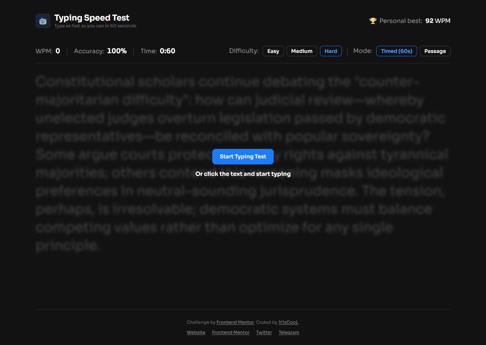
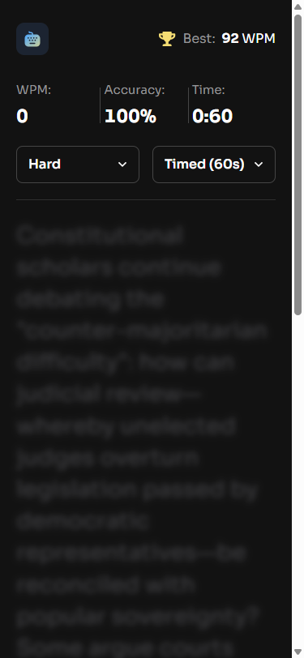

# Frontend Mentor - Typing Speed Test solution

This is a solution to the [Typing Speed Test challenge on Frontend Mentor](https://www.frontendmentor.io/challenges). Frontend Mentor challenges help you improve your coding skills by building realistic projects.

## Table of contents

- [Overview](#overview)
  - [The challenge](#the-challenge)
  - [Screenshot](#screenshot)
  - [Links](#links)
- [My process](#my-process)
  - [Built with](#built-with)
  - [What I learned](#what-i-learned)
  - [Continued development](#continued-development)
  - [Useful resources](#useful-resources)
- [Development](#development)
- [Author](#author)

## Overview

### The challenge

Users should be able to:

- Start a test by clicking the start button **or** by clicking the passage and typing
- Select a difficulty level (Easy, Medium, Hard) for passages of varying complexity
- Switch between **Timed (60s)** mode and **Passage** mode (timer counts up, no limit)
- Restart at any time to get a new random passage from the selected difficulty
- See real-time **WPM**, **accuracy**, and **time** while typing
- See per-character feedback — correct (green), errors (red + underline), and the cursor position
- Correct mistakes with backspace (original errors still count against accuracy)
- View results with WPM, accuracy, and characters (correct/incorrect) after a test
- See a **"Baseline Established!"** message on the first test, a **"High Score Smashed!"** celebration with confetti when beating the personal best, and **"Test Complete!"** otherwise
- Have their personal best persist across sessions via `localStorage`
- View the optimal layout depending on their device's screen size (375px / 1440px designs)
- See hover and focus states for all interactive elements

### Screenshot

| Desktop                              | Mobile                             |
| ------------------------------------ | ---------------------------------- |
|  |  |

### Links

- Solution URL: [Vercel](https://typing-speed-test-main-eight.vercel.app/)
- Live Site URL: [mmalabugin.ru/TypingSpeedTest](https://mmalabugin.ru/TypingSpeedTest/)

## My process

### Built with

- Semantic HTML5 markup with landmark regions (`header` / `main` / `section[aria-label]` / `footer`)
- CSS custom properties, Flexbox, `clamp()`-free fluid column (`width: min(100% - 3rem, 1230px)`), desktop-first media queries
- **[Alpine.js 3](https://alpinejs.dev/) + Vite 7 + TypeScript** — the whole typing engine is a single `Alpine.data('typingTest', …)` component; reactive getters drive WPM/accuracy/time, and per-character `:class` bindings colour the passage
- Feature-Sliced Design: `app` → `pages` → `widgets` → `features` → `shared`; the engine state machine lives in `features/typing-engine`, pure stat math (`computeWpm` / `computeAccuracy` / `classifyResult`) is split out and unit-tested
- Self-hosted **Sora** (`font-display: optional` + `<link rel="preload">`) to avoid font-swap layout shift
- Passage font recovered from the design JPGs (≈40px/2.5rem desktop so a ~54-char line fills the column, line-height 1.35)
- Vitest for the stat helpers and the engine state machine (typing, backspace accounting, completion, restart)

### What I learned

- Alpine's fine-grained reactivity makes a 500-span passage cheap: folding the cursor into the per-character `state` array means a keystroke only re-runs the two `:class` effects whose index actually changed, instead of all 500.
- Keystrokes are captured through an off-screen, JS-focused `<input>` and handled in a single `@keydown`; printable keys and `Backspace` are `preventDefault`-ed so the engine owns all state. The original error count is never decremented on backspace, so fixed mistakes still weigh on accuracy exactly as the brief requires.
- `performance.now()` drives the elapsed clock (a 200ms interval only repaints), so timed mode ends precisely at 60s and WPM stays accurate even when a short passage is finished early.
- Vite's `%BASE_URL%` replacement in `index.html` keeps the `@font-face`, preload, and favicon URLs identical for `/` (Vercel) and `/TypingSpeedTest/` (self-hosted), and `import.meta.env.BASE_URL` does the same for every runtime asset.
- Wrapping every `transition`/`animation` in `@media (prefers-reduced-motion: no-preference)` satisfies motion preferences without an `!important` reduced-motion reset.

### Continued development

- A diff-based `input` fallback so soft-keyboard mobile browsers that don't emit per-key `keydown` can still be typed into.
- A results history / sparkline persisted alongside the personal best.
- Per-word rendering to guarantee no mid-word breaks on very narrow viewports.

### Useful resources

- [Alpine.js docs](https://alpinejs.dev/) — `Alpine.data`, reactive getters, `x-for`, `x-transition`, and the `$refs` / `$nextTick` magics.
- [Vite: HTML env replacement](https://vite.dev/guide/env-and-mode.html#html-constant-replacement) — `%BASE_URL%` for fonts/favicon across deploy bases.
- [Feature-Sliced Design](https://feature-sliced.design/) — layering the engine vs. widgets vs. shared helpers.

## Development

```bash
npm install
npm run dev      # http://localhost:5173
npm run test     # vitest (stat helpers + engine state machine)
npm run build    # tsc + vite build → dist/
```

Deploy convention: `main` targets Vercel (`base` in `vite.config.ts` stays commented). The `deploy` branch enables `base: '/TypingSpeedTest/'` and is built by Jenkins into a Docker image (nginx) deployed to Kubernetes behind the shared Traefik ingress (`ingresses` repo).

## Author

- Website - [mmalabugin.ru](https://mmalabugin.ru/)
- Frontend Mentor - [@1t1sCooL](https://www.frontendmentor.io/profile/1t1sCooL)
- Twitter - [@vi_el_mar](https://www.twitter.com/vi_el_mar)
- Telegram - [@ItIsCooL](https://t.me/ItIsCooL)
